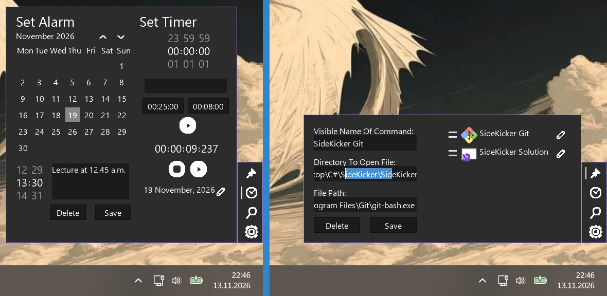

# SideKicker

A sliding sidebar for Windows with quick shortcuts and time tools, a quick-access helper software.

## Features
- Open it by moving the mouse into a screen zone, or via a global keyboard shortcut (ALTGR + <)
- Shortcuts: launch any app/file/folder
- Alarms with messages and repeating alarms, timer and chronometer
- File finder for the Desktop
- Light on resources: ~50 MB idle, ~75 MB in use

## Requirements
- .NET 10.0
- MonoGame 3.8.0 or above (required by [PopUpUI](https://github.com/alpakca/PopUpUI))

## Build & run
1. Reference [PopUpUI](https://github.com/alpakca/PopUpUI) as a project reference.
2. Compile the solution as it appears in the repo.
3. Before running the executable, copy the `assets` folder into the same
   folder as the compiled executable.

## Platform
Originally built for Windows. OS-specific code sits behind a Native Services
abstraction layer, so a port is possible.

## Notes
Built solo in about 30 days (summer 2026) for personal use.